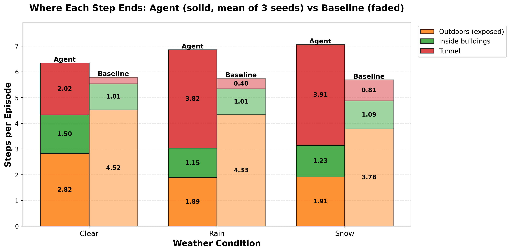
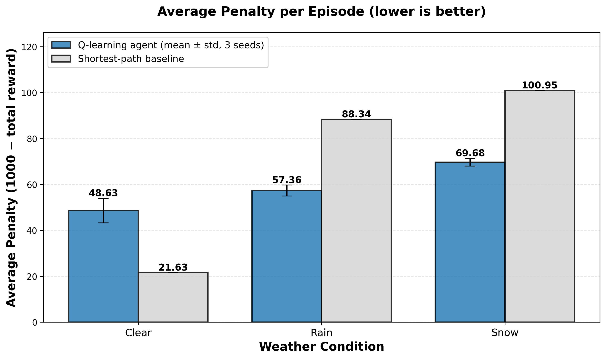
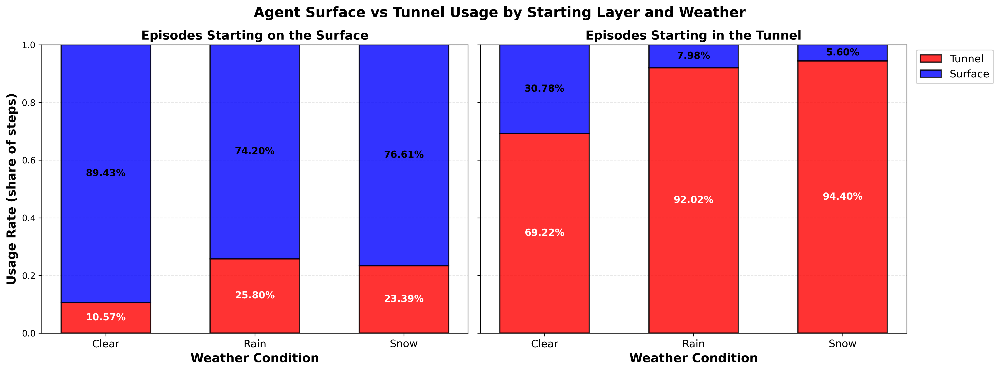
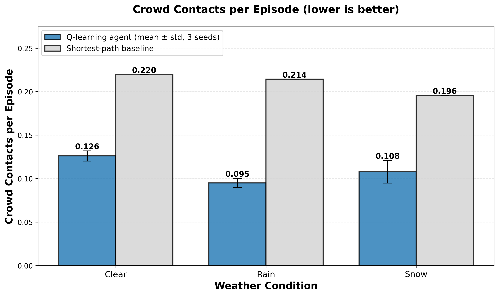
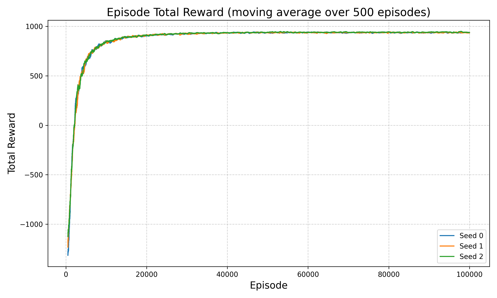

# Updated_Nagivation_Agent

A tabular Q-learning agent that navigates a 20×20 grid of the Northeastern campus, with a surface layer and an underground tunnel layer. It must reach Snell Library while weather (clear, rain, snow) and moving crowds change which route is best.

This repo revisits an earlier group project. The goal of the update is to make the agent **actually learn weather-aware routes** and to **measure that properly**.

## What Changed

**1. Reward function: removed exploits, made it consistent**
- Removed the +10 per step reward for walking in the tunnel during bad weather. The agent could farm it by circling in the tunnel, which paid more than reaching the goal.
- Replaced the one-off time bonus at the goal with a per-step time cost (−2 per time unit). The agent now feels every step, including `WAIT`.
- Removed the ±300 toggle reward and the −800 timeout penalty. Both were far larger than every other term and dominated learning.
- Rain / snow penalty per exposed step raised to −10 / −15, roughly "one step in the rain ≈ 5 extra time units".

**2. State: relative crowd position**
- The nearest crowd was stored as absolute coordinates, so a crowd moving across the map created a brand-new state. It is now an offset clipped to a 5×5 window around the agent.

**3. Training**
- Optimistic Q initialization (1000), so the agent tries the multi-step "walk to entrance → enter tunnel" route.
- 100k episodes instead of 30k, γ = 0.99 (was 0.9), ε decays to 0.05 by ~50k episodes, and learning rate floored at 0.1.

**4. Evaluation: a different standard**

| | Original project | Now |
|---|---|---|
| Policy at evaluation | Softmax sampling | Greedy (same as training) |
| Reference point | None | Shortest-time path (Dijkstra) from the **same start, layer and weather** |
| Runs | 1 | 3 training seeds, reported as mean ± std |
| Main metrics | Average reward, layer usage share | Reward vs. baseline, **steps exposed outdoors**, crowd contacts, time |

## Results

10,000 evaluation episodes per seed. Agent values are mean ± std over 3 seeds. The baseline takes the fastest route and ignores weather discomfort and crowds. Both reach the goal in 100% of episodes.

| | Clear: agent | Clear: baseline | Rain: agent | Rain: baseline | Snow: agent | Snow: baseline |
|---|---|---|---|---|---|---|
| Total reward | 951.4 ± 5.4 | **978.4** | **942.6 ± 2.4** | 911.7 | **930.3 ± 1.7** | 899.1 |
| Outdoor steps / episode | 2.82 | 4.52 | **1.89** | 4.33 | **1.91** | 3.78 |
| Tunnel steps / episode | 2.02 | 0.26 | **3.82** | 0.40 | **3.91** | 0.81 |
| Crowd contacts / episode | **0.126** | 0.220 | **0.095** | 0.214 | **0.108** | 0.196 |
| Time to goal | 12.1 | **8.6** | 14.1 | **10.2** | 15.4 | **11.7** |

- **Rain and snow:** the agent scores about 31 points more than the baseline and spends roughly half as many steps exposed outdoors. It does this by moving into the tunnel.
- **Crowds:** in all three weather conditions, the agent has 43–56% fewer crowd contacts.
- **Cost:** routes take 30–40% longer. In clear weather the agent scores below the baseline.

**Where each step ends** (new metric). The "share of steps per layer" chart used previously hid this: it counted indoor and outdoor surface steps as the same thing.



**Penalty per episode** (1000 − total reward, lower is better):



**Tunnel usage, split by starting layer.** Half of all episodes start in the tunnel, which inflated tunnel usage in the original chart.



**Crowd contacts:**



**Training curve (3 seeds):**



## Limitations

- **Clear weather is worse than the baseline.** The agent takes detours through buildings and the tunnel that a shortest path does not need.
- **Far from optimal.** A reward-optimal planner (Dijkstra on the same reward, crowds ignored) scores 959 in rain and 953 in snow. The agent captures about 60% of the possible improvement over the baseline. Episodes that start on the surface are the weakest, likely because the crowd window splits each surface cell into many rarely visited states.
- **The comparison uses the agent's own reward.** The baseline does not try to avoid weather, so a larger weather penalty widens the gap automatically. In earlier runs with −4/−5 (before the training changes), the agent only tied the baseline in rain and fell behind in snow. The penalty is a preference setting, not a measured fact.
- **Small, fixed setting.** One goal building, a 20×20 grid, randomly moving crowds, and a tabular Q-table that does not generalize across states.

## Future Work

- Add the reward-optimal planner to the evaluation script as an explicit upper bound.
- Replace the Q-table with function approximation (e.g. DQN), so crowd configurations don't fragment the state space.
- Make the goal part of the state, so a single agent can navigate to any building.
- More realistic dynamics: slippery surfaces in snow, crowd hotspots by location and time of day.

## Setup and Usage

Requires Python 3.8–3.11 (`numpy==1.24.3` does not install on newer versions).

```bash
pip install -r requirements.txt
python Q_learning.py train   # trains 3 seeds × 100k episodes, saves Q_table_*_seed{0,1,2}.pickle
python Q_learning.py         # evaluates against the baseline, prints tables, saves charts
```

| File | Contents |
|---|---|
| `campus_env.py` | Gym environment: map, time costs, reward function |
| `Q_learning.py` | Training, shortest-path baseline, evaluation and charts |
| `campus_gui.py` | pygame visualization (`python Q_learning.py gui`) |
